# Tender Matcher — System Design

_Draft, updated 2026-11-02_

**One-liner:** every day, find the public tenders a small company is **eligible for and relevant to**, explain why each fits, and list its eligibility requirements with quotes from the tender. The owner decides whether to bid.

**Changes in this version:**
- The fit label now comes from a shared [rubric](rubric.md): the LLM scores each criterion, and **code** computes `strong` / `possible` / `no`.
- New section: [Data storage and freshness](#data-storage-and-freshness).
- New [evaluation](#evaluation) sampling plan that also covers the tenders the pipeline drops, plus an award-history backtest.
- The cost section now separates what's measured from what's assumed.

---

## Problem and current process

**Who:** small companies (1–50 people) that sell to government: IT services, consulting, construction, facilities, cleaning, training. Many qualify for **small-business set-asides**: contracts that are reserved for, or favour, small firms.

**How it's handled today:**
1. The owner or a sales person logs in to tender portals (SAM.gov in the US, TED in the EU, national and local portals) a few times a week, if they remember.
2. They search by keywords and industry codes, or rely on the portal's saved-search emails.
3. They scan dozens of titles, open the promising ones, and read long descriptions to check eligibility: certifications, past experience, location, contract size, security clearances, deadlines.
4. They decide whether to bid.

**What it costs:**
- Hours a week of reading, with most of it irrelevant.
- Good tenders get missed because they're worded differently ("digital modernisation" vs. "software development") or filed under the wrong industry code.
- Tenders spotted too late to prepare a bid.
- A single missed contract can be worth tens to hundreds of thousands of dollars.

**Rules vs. judgment:**

| Sub-task | Rules or judgment? | Why |
|---|---|---|
| Fetch new tenders daily | Rules | Public API, fixed schedule |
| Drop closed tenders and notice types that aren't bid opportunities | Rules | Structured fields |
| Drop tenders the company isn't eligible for (set-aside type, location) | Rules | Structured fields; exact matching |
| Turn company documents into a structured profile | **Judgment (LLM)** + human confirmation | Free text in many formats |
| Find tenders related to the company's capabilities | Retrieval (embeddings) | Fuzzy meaning match; keywords miss synonyms |
| Pull out the eligibility and experience requirements written in the description | **Judgment (LLM)** | Requirements are buried in prose, written differently by every agency |
| Score each [rubric](rubric.md) criterion (requirement met / not met / unknown, scope, size, teaming) against the profile | **Judgment (LLM)**, with `unknown` allowed | Partial information, fuzzy scope matching; must not guess |
| Turn the criterion scores into `strong` / `possible` / `no` + a reason code | **Rules** (rubric step 2) | The same rules for the LLM, hand labels and feedback; unit-testable |
| Check the LLM's quotes and dates | Rules | Quotes must appear in the text word for word; dates come from API fields |

**Atomic unit of work:** `judge(tender, profile) → criteria JSON`, followed by `score(criteria) → (label, reason_code)`. The first is the only LLM call in the daily loop. The second is a pure function with one unit test per rubric rule.

**What the LLM steps need around them:**
- **Data:** only the tender text and the confirmed company profile. No web browsing.
- **Checks:** a checker on every output (quotes exist, dates match, format is valid). The LLM never sets the final label; code does.
- **Human review:** the owner confirms the profile once, and decides on every bid. The tool only recommends.

---

## Inputs and outputs

### Inputs

| Input | What it is | How it enters | Structure | Volume |
|---|---|---|---|---|
| Company documents | Capability statement, website "About/Services" text, list of past contracts | Uploaded once (PDF/text), edited later | Unstructured | 1–5 documents per company |
| Company profile | Result of the profile builder, confirmed by the owner | Saved in Postgres | Structured JSON (below) | 1 per company |
| Tender notices | Opportunities from the **SAM.gov Opportunities API** (free API key) | Daily batch job | Structured fields + free-text description | **Not measured yet.** Roughly hundreds to a few thousand new notices per day; see [Volume](#volume-not-measured-yet) |
| Award notices | Who won which contract (SAM.gov award notices, USAspending API) | Batch, for evaluation only | Structured | Historical |
| User feedback | "Pursue" / "not relevant + reason code" on each digest item | Click in the digest | Structured | A few per day |

**How clean is it?**
- Descriptions vary from one line to several pages.
- Agencies sometimes pick the wrong industry code.
- Key requirements are often in **PDF attachments** (out of MVP scope; measured as a known gap).
- Fields can be empty, and the same tender can be posted again as an amendment.

**Company profile (JSON):**

```json
{
  "company_id": "acme-it",
  "profile_version": 3,
  "services": ["cloud migration", "custom web applications", "IT helpdesk"],
  "naics_codes": ["541511", "541512", "541519"],
  "set_aside_eligibility": ["SBA", "WOSB"],
  "locations_served": ["VA", "MD", "DC", "remote"],
  "contract_size_usd": {"min": 25000, "max": 2000000},
  "certifications": ["ISO 27001"],
  "clearances": [],
  "past_contracts": [{"client": "...", "summary": "...", "value_usd": 300000}],
  "exclusions": ["hardware supply", "construction"]
}
```

### Outputs

**Daily digest** (web page + email), read by the owner or bid manager. Each item:

```json
{
  "notice_id": "string",
  "title": "string",
  "agency": "string",
  "criteria": {
    "requirements": [
      {"type": "eligibility | experience", "requirement": "Must hold FedRAMP Moderate authorization",
       "weight": "major | minor", "status": "met | not_met | unknown",
       "quote": "exact text from the tender"}
    ],
    "scope": {"value": "core | partial | none", "quote": "..."},
    "size": {"value": "in_range | near | far | unknown", "quote": "..."},
    "teaming_needed": false
  },
  "fit": "strong | possible | no",
  "reason_code": "STRONG | POSS_UNKNOWN_REQ | NO_ELIGIBILITY | ...",
  "fit_reasons": ["matches 'cloud migration' service", "within contract size range"],
  "key_dates": {"response_deadline": "2026-11-14", "questions_due": "2026-11-05"},
  "summary": "2-3 sentences",
  "link": "https://sam.gov/opp/...",
  "rubric_version": "v1",
  "prompt_version": "judge-v2",
  "model": "claude-sonnet / qwen-8b"
}
```

`criteria`, `fit_reasons` and `summary` come from the LLM. `fit` and `reason_code` are computed by code from `criteria` using the [rubric](rubric.md). `key_dates` are copied from the API fields.

**What "correct" means:**
- **Matching:** tenders a human labels `strong` or `possible` under the [rubric](rubric.md) appear in the digest. **No good tender should be missed.** Tenders labelled `no` are filtered out or shown last.
- **Criteria:** every real requirement in the description is listed; each `quote` appears word for word in the tender; each criterion score agrees with a human scoring it with the same rubric; `unknown` is used when the profile or text doesn't say.
- **Label:** follows from the criteria, so it's correct whenever the criteria are (the rules are unit-tested).
- **Dates:** taken from the structured API fields, never from the LLM. Must match exactly.
- **Summary:** contains nothing that isn't in the tender (checked by a human on a sample).

---

## Data flow

```
Daily (scheduled job):
Step 1  Fetch       → pull notices posted since the last successful run (plus a 3-day overlap) from the SAM.gov API; upsert by notice_id
Step 2  Change check→ fingerprint each notice (description + deadline); new or changed → mark for embedding and judging
Step 3  Embed       → embed new or changed descriptions (once per tender version, shared across companies)
Step 4  Hard filter → per company: drop closed tenders, non-bid notice types, set-asides they aren't eligible for, locations they don't serve
Step 5  Retrieve    → per company: rank by similarity to capabilities; keep the top K (K depends on the measured volume, see Cost)
Step 6  Judge       → LLM scores the rubric criteria for each candidate, with quotes (JSON)
Step 7  Check+score → quotes exist, format valid, dates overwritten from API fields; code applies rubric step 2 → fit + reason code
                      (on check failure: retry once, then mark "needs review")
Step 8  Digest      → rank strong > possible, then by deadline; flag amended tenders ("deadline moved"); send or display
Step 9  Feedback    → user marks pursue / not relevant (+ reason code); saved with the rubric version

One-time per company:
Step 0  Profile     → LLM pulls a profile JSON out of the company documents → **owner reviews and confirms** → saved (versioned) and embedded
```

**State changes:**
- Steps 1–3 write tenders, fingerprints and embeddings.
- Steps 6–7 write matches, each tagged with profile, prompt, rubric and model versions.
- Step 9 writes feedback.
- Nothing is ever deleted (see [Data storage and freshness](#data-storage-and-freshness)).

---

## Data sources per input

| Step | Source / tool | How brittle |
|---|---|---|
| Fetch (MVP) | **SAM.gov Get Opportunities Public API** (free key from api.data.gov / SAM.gov) | Low. Official, documented API. Watch the daily rate limits on free keys |
| Awards (evaluation) | **SAM.gov award notices** + **USAspending.gov API** (free) | Low. Linked to tenders by solicitation number |
| Fetch (later) | **EU TED API** (free, official) · **UK Find a Tender / Contracts Finder** (official APIs) | Low–medium. Each needs its own field mapping |
| Fetch (local portals) | Many national or state portals (e.g. India's CPPP/GeM) have **no public API** | **High.** Scraping breaks when the site changes and may break the site's terms. Kept out of MVP on purpose |
| Attachments | PDFs linked from the notices | Medium. Scanned PDFs need OCR. Out of MVP |
| Profile | The company's own documents | Low |
| Embeddings / LLM | Local embedding model; frontier API or local Qwen | Low |

---

## Components and diagram

```mermaid
flowchart LR
    API[SAM.gov API] -->|daily JSON| F[Tender Fetcher]
    F --> DB[(Postgres + pgvector<br/>tenders, versions, embeddings)]
    DOCS[Company docs] --> PB[Profile Builder LLM]
    PB -->|draft profile JSON| H1[Owner confirms]
    H1 -->|profile JSON| DB
    DB --> HF[Hard Filter<br/>SQL rules]
    HF -->|candidate ids| R[Retriever<br/>vector similarity]
    R -->|top K tenders| J[Fit Judge LLM<br/>scores criteria]
    DB -->|profile| J
    J -->|criteria JSON| C[Checker]
    C -->|retry / needs review| J
    C -->|valid criteria| S[Rubric Scorer<br/>code]
    S -->|fit + reason code| D[Digest<br/>web + email]
    D --> U[Owner / bid manager]
    U -->|pursue / not relevant + reason| FB[Feedback]
    FB --> DB
```



| Component | Job | Deterministic ↔ agent | Output format |
|---|---|---|---|
| Tender Fetcher | Pull and upsert new notices, fingerprint them, track versions | Deterministic | Rows in `tenders`, `tender_versions` |
| Profile Builder | Draft a structured profile from documents | Single LLM call, structured output; **human confirms** | Profile JSON |
| Hard Filter | Rules on structured fields | Deterministic (SQL) | List of tender ids |
| Retriever | Rank by meaning similarity | Deterministic (pgvector query) | `[{notice_id, score}]` |
| Fit Judge | Score rubric criteria with quotes, give reasons and a summary | **Single LLM call per tender, structured output. Not an agent:** no tools, no loop | Criteria JSON |
| Checker | Check quotes, overwrite dates, validate format | Deterministic | pass / fail + reason |
| Rubric Scorer | Apply [rubric](rubric.md) step 2 | Deterministic (pure function, unit-tested) | `fit`, `reason_code` |
| Digest | Rank and display | Deterministic | HTML / email |
| Feedback | Store user decisions + reason codes | Deterministic | Rows in `feedback` |

The LLM is limited to two single-shot calls (profile, judge), and it never chooses the final label. That makes every step testable on its own, and a disagreement can always be traced to one criterion. An agent that browses attachments or related notices is a possible v2.

---

## Model and tool choices

| Need | Choice | Why |
|---|---|---|
| Fit judge (first pass) | Frontier model (e.g. Claude Sonnet) | Sets the quality target; strong at reading long, formal procurement text and returning structured output |
| Fit judge (comparison) | Qwen 7–8B instruct via Ollama | Runs once per candidate per company per day, so cost grows with volume and customers. Scoring criteria is a narrow task a small model may handle. **This gets measured, criterion by criterion** |
| Profile builder | Frontier model | Runs once per company, and quality matters more than cost |
| Summaries | Small model | Easy task; low risk because the checker and source link are always shown |
| Embeddings | Small open model (e.g. `bge-small`, 384 dimensions), local | Free; thousands of short descriptions a day |

**First pass with a strong model:** _to fill in after running about 50 real SAM.gov notices for one sample company through the frontier model. Record:_
- _where it was unsure, and which requirements it missed_
- _**what share of tenders have their key requirements only in attachments.** If it's high, the criteria will be mostly `unknown`, and parsing PDFs that contain text moves into the MVP_
- _which rubric criteria it found hardest to score_

---

## The stack

- **Python 3.12.**
- **PostgreSQL + pgvector.** One free database for tenders, profiles, embeddings, matches, feedback and evaluation labels. Rule filters and vector ranking can run in one SQL query, so there's no separate vector database to run. Locally in Docker (`pgvector/pgvector`); hosted on Supabase or Neon free tiers for a demo.
- **Scheduling:** cron or APScheduler for the daily job.
- **API + UI:** FastAPI with a simple HTML digest page (or Streamlit for speed).
- **Plain SDK calls** (Anthropic SDK / Ollama HTTP), with **Pydantic** for the output formats. No orchestration framework needed.
- **Langfuse** for tracing tokens, cost and latency.
- **pytest** for the filter, checker, rubric scorer and fetcher.

```sql
-- candidates for one company: hard rules + similarity in one query
SELECT t.notice_id, t.title, 1 - (t.embedding <=> :capability_embedding) AS similarity
FROM tenders t
WHERE t.status = 'open'
  AND t.response_deadline > now() + interval '5 days'
  AND (t.set_aside IS NULL OR t.set_aside = ANY(:eligible_set_asides))
  AND t.notice_type IN ('Solicitation', 'Combined Synopsis/Solicitation')
ORDER BY t.embedding <=> :capability_embedding
LIMIT :k;
```

---

## Data storage and freshness

### Why a database at all

For the vector search alone, no database is needed: a few thousand embeddings fit in memory. The database is needed because **a daily job has to remember things between runs**:

| What has to be remembered | Why |
|---|---|
| Which tenders were already fetched | Each run only pulls new ones, with no duplicates |
| Each tender's embedding | Computed once per tender version and reused for every company |
| Match results per company | The digest doesn't repeat itself, and old decisions can be re-checked |
| User feedback | A growing set of labels for improving matches |
| Award history + evaluation labels | Joined to tenders for the backtest |
| Profile, prompt, rubric and model versions | Every result can be traced to what produced it |

**Why Postgres + pgvector:**
- Hard filters and similarity ranking run in one query.
- Ordinary tables are needed for profiles, matches and feedback anyway, so one database does both jobs.

**Alternative considered:** SQLite + `sqlite-vec` would also work at MVP scale, as a single file with no server. Postgres was chosen because it's easier to host and handles several companies better later on.

**Size:** one 384-dimension embedding is about 1.5 KB, so a million tender versions is about 1.5 GB.

### Main tables

| Table | Key columns |
|---|---|
| `tenders` | `notice_id` (PK), `solicitation_number`, `status` (open / closed / cancelled), `current_version`, structured fields |
| `tender_versions` | `notice_id`, `version`, `fingerprint`, `description`, `response_deadline`, `embedding vector(384)`, `embedding_model`, `fetched_at` |
| `companies`, `profiles` | `profiles` versioned: `company_id`, `profile_version`, profile JSON, `embedding` |
| `matches` | `company_id`, `notice_id`, `tender_version`, `profile_version`, `prompt_version`, `rubric_version`, `model`, criteria JSON, `fit`, `reason_code` |
| `feedback` | `company_id`, `notice_id`, decision, `reason_code`, `rubric_version`, timestamp |
| `awards` | `solicitation_number`, awardee, value, date |
| `labels` | `company_id`, `notice_id`, labeller, criteria JSON, `fit`, `reason_code`, `rubric_version`, `sample_stratum` |
| `runs` | start/end time, window fetched, counts at each step, errors |

### How it stays up to date

1. **Daily fetch with an overlap.** Store the date of the last successful run; each day, pull notices posted since then **plus the 3 days before**, to catch late postings and outages. Page through results and stay within the API's rate limits.
2. **Re-running is safe.** Tenders are upserted by `notice_id`, so a failed run can simply be repeated without creating duplicates.
3. **Amendments.** Agencies post changes under the same `solicitation_number`. Each version stores a fingerprint of its description and deadline. If the fingerprint changes: add a new version, re-embed, re-judge for companies it matched, and flag it in the digest ("deadline moved to Nov 20"). Old versions are kept, so the backtest knows what was published when.
4. **Closed tenders are marked, not deleted.** The filter hides them (`status`, `response_deadline`), but they stay for the backtest and for linking award notices.
5. **Only recompute what changed:**

| What changed | What gets redone |
|---|---|
| New tender | Embed; filter and judge for each company |
| Tender amended (fingerprint changed) | Re-embed; re-judge for affected companies |
| Company profile edited | Re-judge **open** tenders for that company only |
| Prompt or LLM model changed | Re-judge open tenders; keep old results for comparison |
| Rubric step 2 changed | Re-run the scorer on stored criteria. **No LLM calls** |
| Rubric step-1 meaning changed | Re-judge open tenders; flag affected labels for relabelling |
| Embedding model changed | Re-embed **everything** (`embedding_model` column shows which vectors are old) |

**Not stored:** PDF attachments. Links only for now; if attachments are added later, store the extracted text, not the files.

---

## Human-in-the-loop

| Point | What the human does | Why |
|---|---|---|
| Company profile | Owner reviews and corrects the drafted profile before it's used | A wrong certification or industry code would wrongly filter out every relevant tender |
| Every bid decision | Owner reads the digest and the original tender, then decides | Bidding takes time and money; the tool only recommends and never bids |
| `unknown` requirements / "needs review" | Shown clearly so a human checks the source | Better to admit missing information than to guess |
| Feedback | "Not relevant" + a reason code from the rubric | Labelled data in the same format as the evaluation labels |
| Rubric calibration | Label ~20 tenders, tighten the wording, freeze v1 | The labels are only as consistent as the rubric |
| Evaluation labels | Score rubric criteria for the sampled tenders (me, plus contractors if available) | No public dataset of "fit for company X" exists |

---

## Evaluation

### Choosing which tenders to label

**The trap:** if only the pipeline's own candidates were labelled, every tender it dropped would never be checked, and recall would look perfect. So labels are sampled from the **full pool, before any filtering**:

1. Take all notices from a fixed window (e.g. 2 weeks) and run the pipeline once for each sample company.
2. Record where each tender ended up, then sample from each group:

| Group | Sample | Why |
|---|---|---|
| Reached the judge | ~60 | Precision of the digest; criterion accuracy |
| Dropped by the ranking, just below the cutoff (ranks K+1 to ~200) | ~45 | The most likely place for misses |
| Dropped by the ranking, further down | ~15 | Confirms deep misses are rare |
| Dropped by the hard filter | ~40 | Checks the rules aren't too strict |
| Random from the whole pool | ~40 | An unbiased check on everything above |

3. Each label stores its group (`labels.sample_stratum`). Because each group's share of the pool is known, results are **weighted back to estimate true recall**, including good tenders lost at each step.

### Positives from outside the pipeline: award backtest

SAM.gov award notices and USAspending show which company won which contract.
- For 2–3 real small companies, build profiles from their public capability statements.
- Take the tenders they actually won, and check whether the pipeline would have surfaced them on the day each was posted.
- These positives come from history, not from the pipeline, so they're a fair test of recall.
- **Caveat:** companies don't bid on everything they could win, so this measures recall but not precision. The hand labels cover precision.

### Who labels

- **Me**, using the [rubric](rubric.md), after calibration. A subset is labelled twice a week apart, to check my own consistency.
- **Contractors, if they agree:** reach out via LinkedIn and small-business support centres. Each is asked to label ~30–50 tenders that were already chosen for **their own** profile, starting with the 20 calibration tenders.
- Their labels are used as ground truth for their company, **and** to measure how often my labels agree with an expert's.
- **If no contractor is available in time:** award backtest + my own labels, and the demo says clearly that the labels are mine and not an expert's.

### Metrics

| Unit | Metric | Data |
|---|---|---|
| Hard filter | Good tenders (`strong` / `possible`) wrongly dropped (target: 0) | Hard-filter group + award backtest |
| Retriever | Weighted recall at cutoff K | All groups, weighted |
| Fit judge: criteria | Agreement with human, **per criterion** (scope, size, each requirement) | Labels |
| Fit judge: label | **Recall** (`strong` + `possible` = should be shown, most important); **top-of-digest precision** (`strong` only); confusion matrix | Labels |
| Rubric scorer | 100% of unit tests pass (one per rule) | Tests |
| Grounding | % of quotes found word for word; % of dates matching the API (target: 100%) | All outputs, checked automatically |
| End to end | Recall on won contracts (backtest); share of the top 10 an expert would look at | Backtest + 1–2 weeks of daily runs |
| Labels themselves | My own consistency (relabelled subset); agreement with contractors | Labels |

**Baselines, to show what each layer adds:**
1. **Keyword + industry-code match** (what portal alerts do today).
2. **Embedding similarity only**, no LLM.
3. **Full pipeline**, frontier model vs. Qwen 7–8B.

**Success for Demo Day:**
- Higher weighted recall and backtest recall than keyword alerts, at similar or better top-of-digest precision.
- 100% grounding.
- A measured, per-criterion comparison of the frontier model vs. the small model on accuracy, cost and speed.

---

## Cost estimation

### Volume (not measured yet)

The number of tenders left for one company after the hard filter **has not been measured**. It's probably large:
- The hard filter deliberately doesn't filter on industry codes, because agencies often pick the wrong one.
- So nothing in the rules checks whether a tender matches the company's **kind of work**. A software firm and a cleaning company get roughly the same list after filtering.
- The ranking does most of the narrowing, not the rules.

**Measurement plan:** pull 1–2 days of real notices, run the hard filter for 2–3 sample profiles, and log the count left after each rule (stored in `runs`).

### Per run

Per judged tender: description (~1.5–4k tokens) + profile (~0.5k) + instructions, rubric and format (~1.5k) ≈ **~4–6k tokens in, ~500 out**.

```
cost per company per day = judged tenders × (input tokens × input price + output tokens × output price)
```

- **With ranking:** judged tenders = K, e.g. 30–50.
- **Judging everything:** judged tenders = everything left after the hard filter, possibly hundreds. That's possibly 10× the ranked cost with a frontier model.
- **Local Qwen:** $0 per call, but at 5–20 s per tender, 300 tenders take 25–100 minutes per company per night. Fine for one company, slow for many.
- Exact dollar figures per model will be filled in from Langfuse and current prices once the volume is measured.

**The measurement decides the design:**
- **A few dozen survive the filter:** drop the ranking step and judge everything. It's simpler, and nothing is lost by being ranked too low.
- **Hundreds survive:** keep the ranking (or add a cheap Qwen pre-screen before the frontier judge), and use the evaluation groups to measure what the ranking drops.

### One-time costs and shared costs

| Item | Estimate |
|---|---|
| Labelling (~200 sampled tenders + calibration + relabelled subset) | About 8–15 hours of human time (the biggest cost) |
| Profile building | 1 frontier call per company |
| Fetch + embed | Once per tender version, shared across all companies |
| Hosting (demo) | $0 on free tiers |

**Business check:** if one customer pays $50–200 a month, model costs per company must stay well below that. That's why the measured volume and the small-model comparison matter for the business, not only for the course.

---

## Privacy and compliance

- **Tender data is public.** No regulated personal or medical data.
- **Company profiles are business-confidential** (pricing ranges, past clients). Store them per company with access control; offer the local-model option for cautious customers.
- **Data source terms:** use only official APIs within their rate limits; no scraping behind logins. Show the official link so the user always reads the original.
- **Not legal advice:** eligibility results are a reading aid. The owner must confirm with the official documents before bidding.

---

## Infrastructure

- **MVP:** fully local. Postgres + pgvector in Docker, Ollama for Qwen and embeddings, optional frontier API, cron for the daily job.
- **Demo / first customers:** a small VM or free tier (Supabase/Neon for the database, Render/Fly.io for the app), with email digests through a free email-sending tier.

---

## Tradeoffs and limitations

**Non-LLM alternative for each LLM step:**

| LLM step | Non-LLM alternative | Why not (or: what the LLM must beat) |
|---|---|---|
| Profile builder | Manual form | Fine, and kept as a fallback; the LLM just saves time getting started |
| Scoring criteria (scope, requirements, size) | Keyword/industry-code rules, or embedding score threshold | Keywords miss synonyms; industry codes are often wrong; similarity can't weigh "they want 10 years of DoD experience". Both are kept as baselines |
| Requirement extraction | Regex for "must", "shall", "required" | Finds sentences, not requirements; can't compare them to the profile |
| Final fit label | *(Already rules)* | The LLM only scores criteria; code decides the label |
| Summary | First paragraph of the description | Often filler text; the LLM's summary is checked for being grounded |

**Known gaps (accepted for now):**
- **PDF attachments** often hold the real scope and requirements. The MVP reads descriptions only, so some criteria will be `unknown`. The first pass measures how often.
- **Eligible and relevant ≠ winnable.** Incumbents, pricing and relationships aren't in the data, so the tool doesn't predict winning.
- **One portal only.** US federal is a narrow slice; state, local and international tenders need more fetchers.
- **Labels from a non-expert** unless contractors take part. Mitigated by the rubric, consistency checks and the award backtest.
- **Cold start:** feedback only helps after some use.

**What would break it:** API changes or rate-limit cuts, a badly wrong company profile (hence the confirmation step), or very short descriptions with everything in attachments.

---

## Business notes

- **Buyers:** small government contractors without a bid team. Possible price: $50–200 a month per company.
- **Competition:** HigherGov, GovSpend, Deltek GovWin and BidNet (US); free portal saved-search alerts. Differentiator: **eligibility checklist with quotes and reasons, priced for very small firms**.
- **Validate before building much:** talk to about 10 small contractors (LinkedIn, local small-business support centres) and ask how they find tenders today and what they'd pay.

---

## Open questions

1. **Volume:** how many tenders per day are left for one company after the hard filter? This decides whether the ranking step stays (see [Cost](#cost-estimation)).
2. **Attachments:** what share of tenders have their key requirements only in PDFs, and does PDF parsing need to be in v1?
3. **Rubric thresholds:** is "within 2×" right for `near`, and "at most one minor unknown" right for `strong`? To be settled in calibration.
4. **Contractors:** can I get 1–2 real contractors to label for their own profiles in time?
5. **Model split:** can Qwen score the criteria as well as the frontier model, with the frontier model kept only for requirement extraction?
6. **Market:** US (SAM.gov, best API), EU (TED), or my local market? The answer changes the data source and the buyers.
