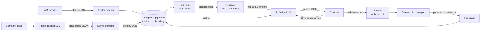

# Tender Matcher — System Design

_Draft, 2026-10-26_

**One-liner:** every day, find the public tenders a small company is eligible for and could realistically win, explain why each fits, and list its eligibility requirements with quotes from the tender. The owner decides whether to bid.

---

## Problem and current process

**Who:** small companies (1–50 people) that sell to government: IT services, consulting, construction, facilities, cleaning, training. Many qualify for **small-business set-asides**: contracts that are reserved for, or favour, small firms.

**How it's handled today:**
1. The owner or a sales person logs in to tender portals (SAM.gov in the US, TED in the EU, national and local portals) a few times a week, if they remember.
2. They search by keywords and industry codes, or rely on the portal's saved-search emails.
3. They scan dozens of titles, open the promising ones, and read long descriptions to check eligibility: certifications, past experience, location, contract size, security clearances, deadlines.
4. They decide whether to bid.

**What it costs:**
- Hours a week of reading, with most of it irrelevant.
- Good tenders get missed because they're worded differently ("digital modernisation" vs. "software development") or filed under the wrong industry code.
- Tenders spotted too late to prepare a bid.
- A single missed contract can be worth tens to hundreds of thousands of dollars.

**Rules vs. judgment:**

| Sub-task | Rules or judgment? | Why |
|---|---|---|
| Fetch new tenders daily | Rules | Public API, fixed schedule |
| Drop closed tenders and notice types that aren't bid opportunities | Rules | Structured fields |
| Drop tenders the company isn't eligible for (set-aside type, location) | Rules | Structured fields; exact matching |
| Turn company documents into a structured profile | **Judgment (LLM)** + human confirmation | Free text in many formats |
| Find tenders related to the company's capabilities | Retrieval (embeddings) | Fuzzy meaning match; keywords miss synonyms |
| Decide whether the company **can realistically win** | **Judgment (LLM)** | Weighs scope, size, experience required and specialisation against the profile |
| Pull out the eligibility requirements written in the description | **Judgment (LLM)** | Requirements are buried in prose, written differently by every agency |
| Check met / not met / unknown against the profile | **Judgment (LLM)**, with "unknown" allowed | Partial information; must not guess |
| Check the LLM's quotes and dates | Rules | Quotes must appear in the text word for word; dates come from API fields |

**What the LLM steps need around them:**
- **Data:** only the tender text and the confirmed company profile. No web browsing.
- **Checks:** a checker on every output (quotes exist, dates match, format is valid).
- **Human review:** the owner confirms the profile once, and decides on every bid. The tool only recommends.

---

## Inputs and outputs

### Inputs

| Input | What it is | How it enters | Structure | Volume |
|---|---|---|---|---|
| Company documents | Capability statement, website "About/Services" text, list of past contracts | Uploaded once (PDF/text), edited later | Unstructured | 1–5 documents per company |
| Company profile | Result of the profile builder, confirmed by the owner | Saved in Postgres | Structured JSON (below) | 1 per company |
| Tender notices | Opportunities from the **SAM.gov Opportunities API** (free API key) | Daily batch job | Structured fields + free-text description | Roughly hundreds to a few thousand new notices per day (check during the first pull) |
| User feedback | "Pursue" / "not relevant + reason" on each digest item | Click in the digest | Structured | A few per day |

**How clean is it?**
- Descriptions vary from one line to several pages.
- Agencies sometimes pick the wrong industry code.
- Key requirements are often in **PDF attachments** (out of MVP scope; measured as a known gap).
- Fields can be empty, and the same tender can be posted again as an amendment.

**Company profile (JSON):**

```json
{
  "company_id": "acme-it",
  "services": ["cloud migration", "custom web applications", "IT helpdesk"],
  "naics_codes": ["541511", "541512", "541519"],
  "set_aside_eligibility": ["SBA", "WOSB"],
  "locations_served": ["VA", "MD", "DC", "remote"],
  "contract_size_usd": {"min": 25000, "max": 2000000},
  "certifications": ["ISO 27001"],
  "clearances": [],
  "past_contracts": [{"client": "...", "summary": "...", "value_usd": 300000}],
  "exclusions": ["hardware supply", "construction"]
}
```

### Outputs

**Daily digest** (web page + email), read by the owner or bid manager. Each item:

```json
{
  "notice_id": "string",
  "title": "string",
  "agency": "string",
  "fit": "strong | possible | no",
  "fit_reasons": ["matches 'cloud migration' service", "within contract size range"],
  "eligibility": [
    {"requirement": "Must hold FedRAMP Moderate authorization", "status": "not_met | met | unknown",
     "quote": "exact text from the tender"}
  ],
  "key_dates": {"response_deadline": "2026-11-14", "questions_due": "2026-11-05"},
  "summary": "2-3 sentences",
  "link": "https://sam.gov/opp/..."
}
```

**What "correct" means:**
- **Matching:** tenders a human expert would call a fit appear in the digest (above all, **no good tender is missed**), and items rated `no` are filtered out or shown last.
- **Eligibility:** every real requirement in the description is listed; each `quote` appears word for word in the tender; `met` / `not_met` agrees with the profile; `unknown` is used when the profile doesn't say.
- **Dates:** taken from the structured API fields, never from the LLM. Must match exactly.
- **Summary:** contains nothing that isn't in the tender (checked by a human on a sample).

---

## Data flow

```
Daily (scheduled job):
Step 1  Fetch       → pull notices posted since the last run from the SAM.gov API; save them; skip duplicates and amendments
Step 2  Hard filter → per company: drop closed tenders, non-bid notice types, set-asides they aren't eligible for, locations they don't serve
Step 3  Embed       → embed new tender descriptions (once per tender, shared across all companies)
Step 4  Retrieve    → per company: rank the remaining tenders by similarity to the company's capability chunks; keep the top ~30–50
Step 5  Judge       → LLM reads each candidate + profile → fit, reasons, eligibility checklist, summary (JSON)
Step 6  Check       → quotes exist in the text, format is valid, dates overwritten from API fields; on failure retry once, then mark "needs review"
Step 7  Digest      → rank strong > possible, then by deadline; send or display
Step 8  Feedback    → user marks pursue / not relevant (with reason); saved and used as examples for the judge and to adjust the profile

One-time per company:
Step 0  Profile     → LLM pulls a profile JSON out of the company documents → **owner reviews and confirms** → saved and embedded
```

**State changes:** Step 1 writes tenders, Step 3 writes embeddings, Steps 5–6 write match results, Step 8 writes feedback. The company profile only changes with the owner's confirmation.

---

## Data sources per input

| Step | Source / tool | How brittle |
|---|---|---|
| Fetch (MVP) | **SAM.gov Get Opportunities Public API** (free key from api.data.gov / SAM.gov) | Low. Official, documented API. Watch the daily rate limits on free keys |
| Fetch (later) | **EU TED API** (free, official) · **UK Find a Tender / Contracts Finder** (official APIs) | Low–medium. Each needs its own field mapping |
| Fetch (local portals) | Many national or state portals (e.g. India's CPPP/GeM) have **no public API** | **High.** Scraping breaks when the site changes and may break the site's terms. Kept out of MVP on purpose |
| Attachments | PDFs linked from the notices | Medium. Scanned PDFs need OCR. Out of MVP |
| Profile | The company's own documents | Low |
| Embeddings / LLM | Local embedding model; frontier API or local Qwen | Low |

---

## Components and diagram



| Component | Job | Deterministic ↔ agent | Output format |
|---|---|---|---|
| Tender Fetcher | Pull and store new notices, skip duplicates | Deterministic | Rows in `tenders` |
| Profile Builder | Draft a structured profile from documents | Single LLM call, structured output; **human confirms** | Profile JSON |
| Hard Filter | Rules on structured fields | Deterministic (SQL) | List of tender ids |
| Retriever | Rank by meaning similarity | Deterministic (pgvector query) | `[{notice_id, score}]` |
| Fit Judge | Fit rating, reasons, eligibility checklist, summary | **Single LLM call per tender, structured output. Not an agent:** no tools, no loop | Match JSON |
| Checker | Check quotes, overwrite dates, validate format | Deterministic | pass / fail + reason |
| Digest | Rank and display | Deterministic | HTML / email |
| Feedback | Store user decisions | Deterministic | Rows in `feedback` |

Keeping the LLM to two single-shot calls (profile, judge) makes every step testable on its own. An agent that browses attachments or related notices is a possible v2.

---

## Model and tool choices

| Need | Choice | Why |
|---|---|---|
| Fit judge (first pass) | Frontier model (e.g. Claude Sonnet) | Sets the quality target; strong at reading long, formal procurement text and returning structured output |
| Fit judge (comparison) | Qwen 7–8B instruct via Ollama | Runs 30–50 times a day per company, so cost grows with customers. Fit / no fit is a narrow decision a small model may handle. **This gets measured** |
| Profile builder | Frontier model | Runs once per company, and quality matters more than cost |
| Summaries | Small model | Easy task; low risk because the checker and source link are always shown |
| Embeddings | Small open model (e.g. `bge-small`, 384 dimensions), local | Free; thousands of short descriptions a day |

**First pass with a strong model:** _fill in after running about 50 real SAM.gov notices for one sample company through the frontier model. Note where it was unsure, which requirements it missed, and how often descriptions lacked the details that live in attachments._

---

## The stack

- **Python 3.12.**
- **PostgreSQL + pgvector.** One free database for tenders, profiles, embeddings, match results and feedback. Rule filters and vector ranking can run in one SQL query, so there's no separate vector database to run. Locally in Docker (`pgvector/pgvector`); hosted on Supabase or Neon free tiers for a demo.
- **Scheduling:** cron or APScheduler for the daily job.
- **API + UI:** FastAPI with a simple HTML digest page (or Streamlit for speed).
- **Plain SDK calls** (Anthropic SDK / Ollama HTTP), with **Pydantic** for the output formats. No orchestration framework needed.
- **Langfuse** for tracing tokens, cost and latency.
- **pytest** for the filter, checker and fetcher.

**Main tables:** `companies`, `profiles`, `tenders` (with `embedding vector(384)`), `matches`, `feedback`, `labels` (evaluation answer key).

```sql
-- candidates for one company: hard rules + similarity in one query
SELECT t.notice_id, t.title, 1 - (t.embedding <=> :capability_embedding) AS similarity
FROM tenders t
WHERE t.response_deadline > now() + interval '5 days'
  AND (t.set_aside IS NULL OR t.set_aside = ANY(:eligible_set_asides))
  AND t.notice_type IN ('Solicitation', 'Combined Synopsis/Solicitation')
ORDER BY t.embedding <=> :capability_embedding
LIMIT 50;
```

---

## Human-in-the-loop

| Point | What the human does | Why |
|---|---|---|
| Company profile | Owner reviews and corrects the drafted profile before it's used | A wrong certification or industry code would wrongly filter out every relevant tender |
| Every bid decision | Owner reads the digest and the original tender, then decides | Bidding takes time and money; the tool only recommends and never bids |
| `unknown` eligibility / "needs review" | Shown clearly so a human checks the source | Better to admit missing information than to guess |
| Feedback | "Not relevant + reason" | Gives labelled data for improving matching over time |
| Evaluation answer key | Hand-label about 200 tenders per sample company | No public dataset of "fit for company X" exists |

---

## Evaluation

| Unit | Metric | Data |
|---|---|---|
| Hard filter | No good tender wrongly dropped (target: 0 false negatives) | Answer key |
| Retriever | **Recall@50**: % of good tenders that survive to the judge | Answer key |
| Fit judge | **Recall of good tenders** (most important), precision, confusion between strong / possible / no | Answer key, about 200 tenders × 2–3 companies |
| Eligibility checklist | % of real requirements found; met / not met accuracy | About 30 tenders labelled in detail |
| Grounding | % of quotes that appear word for word; % of dates matching the API (target: 100%) | All outputs, checked automatically |
| End to end | Digest precision: share of top-10 items an expert would look at; time saved vs. reading by hand | 1–2 weeks of daily runs |

**Baselines, to show what each layer adds:**
1. **Keyword + industry-code match** (what portal alerts do today).
2. **Embedding similarity only**, no LLM.
3. **Full pipeline**, frontier model vs. Qwen 7–8B.

**Success for Demo Day:**
- The pipeline finds clearly more of the good tenders than the keyword alerts, at similar or better precision.
- 100% grounding.
- A measured comparison of the frontier model vs. the small model on accuracy, cost and speed.

---

## Cost estimation

**Per company per day (rough):**
- 30–50 candidates go to the judge.
- Each call: description (~1.5–4k tokens) + profile (~0.5k) + instructions and format (~1k) ≈ **3–5k tokens in, ~500 out**.
- About 150–250k input tokens a day per company with a frontier model. Multiply by the current per-token price, and use Langfuse for exact numbers.
- With local Qwen, the cost per call is zero; it takes 5–20 s per tender on a laptop GPU or Apple Silicon, which is fine for an overnight job.

**Shared across companies:** fetching and embedding each tender happens once, not once per company.

| One-time cost | Estimate |
|---|---|
| Labelling the evaluation answer key | About 200 tenders × 2–3 companies × ~1–2 min ≈ 8–15 hours of human time (the biggest cost) |
| Profile building | 1 frontier call per company |
| Hosting (demo) | $0 on free tiers |

**Business check:** if one customer pays $50–200 a month, frontier-model costs per company must stay well below that. That's why the small-model comparison matters for the business, not only for the course.

---

## Privacy and compliance

- **Tender data is public.** No regulated personal or medical data.
- **Company profiles are business-confidential** (pricing ranges, past clients). Store them per company with access control; offer the local-model option for cautious customers.
- **Data source terms:** use only official APIs within their rate limits; no scraping behind logins. Show the official link so the user always reads the original.
- **Not legal advice:** eligibility results are a reading aid. The owner must confirm with the official documents before bidding.

---

## Infrastructure

- **MVP:** fully local. Postgres + pgvector in Docker, Ollama for Qwen and embeddings, optional frontier API, cron for the daily job.
- **Demo / first customers:** a small VM or free tier (Supabase/Neon for the database, Render/Fly.io for the app), with email digests through a free email-sending tier.

---

## Tradeoffs and limitations

**Non-LLM alternative for each LLM step:**

| LLM step | Non-LLM alternative | Why not (or: what the LLM must beat) |
|---|---|---|
| Profile builder | Manual form | Fine, and kept as a fallback; the LLM just saves time getting started |
| Fit judgment | Keyword/industry-code rules, or embedding score threshold | Keywords miss synonyms; industry codes are often wrong; similarity can't weigh "they want 10 years of DoD experience". Both are kept as baselines |
| Eligibility extraction | Regex for "must", "shall", "required" | Finds sentences, not requirements; can't compare them to the profile |
| Summary | First paragraph of the description | Often filler text; the LLM's summary is checked for being grounded |

**Known gaps (accepted for now):**
- **PDF attachments** often hold the real scope and requirements. The MVP reads descriptions only, so some eligibility will be `unknown`. Measure how often.
- **"Can realistically win" is only partly visible:** incumbents, pricing and relationships aren't in the data.
- **One portal only.** US federal is a narrow slice; state, local and international tenders need more fetchers.
- **Cold start:** feedback only helps after some use.
- **Amendments** can change deadlines and scope; the MVP keeps only the latest version.

**What would break it:** API changes or rate-limit cuts, a badly wrong company profile (hence the confirmation step), or very short descriptions with everything in attachments.

---

## Business notes

- **Buyers:** small government contractors without a bid team. Possible price: $50–200 a month per company.
- **Competition:** HigherGov, GovSpend, Deltek GovWin and BidNet (US); free portal saved-search alerts. Differentiator: **eligibility checklist with quotes and reasons, priced for very small firms**.
- **Validate before building much:** talk to about 10 small contractors (LinkedIn, local small-business support centres) and ask how they find tenders today and what they'd pay.

---

## Open questions

1. **Market:** US (SAM.gov, best API), EU (TED), or my local market? The answer changes the data source and the buyers.
2. How much of the real requirements live in attachments, and is PDF parsing needed for v1?
3. Should "possible" fits be shown, or only "strong"? This trades missed tenders against noise, which is a product decision.
4. Can the small Qwen model match the frontier model on fit / no fit, with the frontier model kept only for eligibility extraction?
5. How should feedback be used: as examples in the prompt, to edit the profile, or both?
